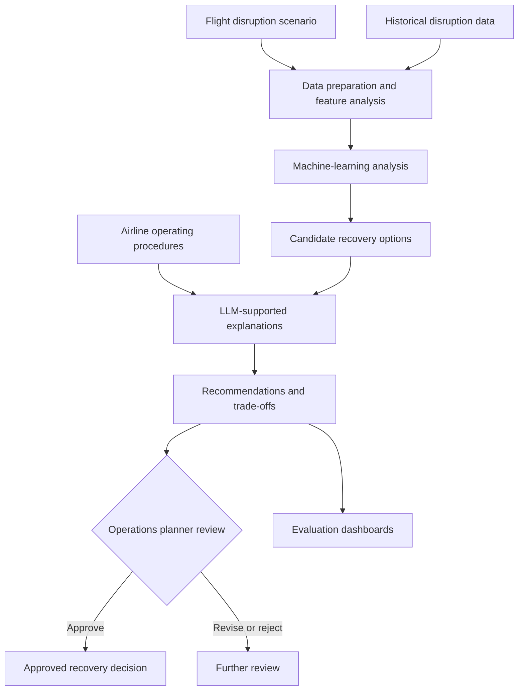

# Flight-Disruption-Recovery-Analytics-and-Decision-Support
AI-powered airline disruption recovery system using Python, scikit-learn, LLMs, and FastAPI to analyze flight delays, recommend rebooking and resource adjustments, and support operational decisions with explainable insights and performance dashboards.

**An AI-assisted decision-support system for analyzing airline disruptions and recommending explainable recovery actions for operations planners.**


## Overview

Flight delays, cancellations, and related disruptions can affect passengers, crews, aircraft availability, and downstream schedules. Operations teams must assess multiple recovery options, often under time pressure and with competing operational constraints.

**Flight Disruption Recovery Analytics & Decision Support** combines historical disruption data, machine-learning analysis, airline operating procedures, and LLM-generated explanations to help an operations planner compare recovery strategies. The system is designed to **recommend actions, not execute them automatically**.

## Key Features

- **Disruption analysis:** Examine flight-delay and disruption scenarios using structured operational data.
- **Recovery recommendations:** Present options such as passenger rebooking, crew reassignment, and aircraft swaps.
- **Explainable AI:** Use historical disruption patterns and airline operating procedures to explain why an option may be appropriate.
- **Human approval:** Keep the operations planner responsible for reviewing and approving a proposed action.
- **Performance dashboards:** Review recommendation accuracy, estimated recovery cost, and response time across evaluation scenarios.
- **API-ready design:** Use FastAPI to expose the analytical and decision-support workflow to other applications.

## How It Works



### Recovery Options

| Option | Decision-support purpose |
| --- | --- |
| **Passenger rebooking** | Consider alternative itineraries for disrupted passengers. |
| **Crew reassignment** | Assess potential crew changes when disruptions affect staffing plans. |
| **Aircraft swap** | Consider substituting an available aircraft to reduce downstream disruption. |

Each recommendation is intended to include an explanation and remain subject to operational review.

## Tech Stack

| Layer | Technologies | Purpose |
| --- | --- | --- |
| **Programming & analytics** | Python, Pandas | Data preparation, transformation, and scenario analysis |
| **Machine learning** | scikit-learn | Analyze historical disruption patterns and support recommendations |
| **Generative AI** | Large Language Models (LLMs) | Produce understandable, procedure-informed explanations |
| **API** | FastAPI | Serve decision-support functionality to clients |
| **Reporting** | Performance dashboards | Compare recommendation accuracy, recovery cost, and response time |

## Evaluation

The project was evaluated against **200 benchmark disruption scenarios**. The evaluation focuses on three dimensions:

| Metric | What it assesses |
| --- | --- |
| **Recommendation accuracy** | How well suggested recovery actions align with benchmark or reference decisions |
| **Recovery cost** | The relative operational cost associated with proposed options |
| **Response time** | How quickly the system produces a recommendation |

Dashboards provide a consolidated view of these metrics for comparing outcomes and identifying improvement opportunities. **Numeric results are not included here** because the benchmark summary values have not been supplied.

## Example Decision-Support Output

The following is a **conceptual illustration** of the type of result the system is intended to provide; it is **not a documented API response schema**.

```json
{
  "scenario_id": "demo-001",
  "disruption_type": "flight_delay",
  "candidate_actions": [
    {
      "action": "passenger_rebooking",
      "explanation": "Consider alternative itineraries for impacted passengers."
    },
    {
      "action": "aircraft_swap",
      "explanation": "Review aircraft availability and downstream schedule impact."
    }
  ],
  "decision_status": "pending_planner_approval"
}
```

## Getting Started

> **Setup note:** The repository's actual file structure and API entry point were not provided. The commands below show a common Python/FastAPI setup and may need to be adapted to the implementation.

### 1. Create a Python environment

```bash
python -m venv .venv
```

Activate it:

```bash
# macOS / Linux
source .venv/bin/activate

# Windows (PowerShell)
.venv\Scripts\Activate.ps1
```

### 2. Install dependencies

If the repository includes a `requirements.txt` file:

```bash
pip install -r requirements.txt
```

### 3. Start the API

For an application exposing a FastAPI instance named `app` in `main.py`:

```bash
uvicorn main:app --reload
```

With that example layout, interactive API documentation is usually available at `http://127.0.0.1:8000/docs`.

Adjust the startup command and configuration to match the repository's actual implementation.

## Responsible Use & Limitations

- Recovery recommendations are **decision support**, not automatic flight-operation instructions.
- A qualified operations planner must verify feasibility, company procedures, crew legality, aircraft availability, and applicable constraints before approving an action.
- Historical data may not represent unusual or rapidly changing operational conditions.
- LLM explanations should be checked against source procedures and the underlying scenario data.
- The 200-scenario benchmark describes the evaluation scope; it does not, by itself, establish production readiness.

## Potential Enhancements

- Integrate real-time flight status and operational data feeds.
- Add explicit constraint checking and side-by-side recovery cost comparisons.
- Support scenario simulation and what-if analysis.
- Track recommendation outcomes and model performance over time.
- Expand benchmark coverage to more disruption types and operating conditions.

---

**Project focus:** Airline operations analytics · Explainable AI · Machine learning · Human-in-the-loop decision support
